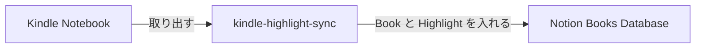

# kindle-highlight-sync

Kindle の Highlight と Note を、Notion の Books Database に同期する macOS 用 CLI。

[](https://github.com/ryokosuge/kindle-highlight-sync-cli/actions/workflows/ci.yml)
[](LICENSE)
[](https://github.com/ryokosuge/kindle-highlight-sync-cli/releases)

Amazon.co.jp の Kindle Notebook から Book ごとの Highlight と Note を取り出し、Notion の Books Database に Book のページと Highlight のブロックとして入れる。



Books Database には Book ごとに 1 ページができる（値は架空）:

| Title | Kindle ID | Author | ASIN | Last Annotated At |
| --- | --- | --- | --- | --- |
| 星降る図書館の地図 | B0EXAMPLE01 | 架空 太郎 | B0EXAMPLE01 | 2026-01-31 |

各ページには Highlight が引用として並び、Note があれば引用の下に本文だけが入る（Note の無い Highlight と、ある Highlight の例）:

> 夜の書庫では、本が自分の居場所を静かに覚えている。
> Location 120 · khs:a-3c91e5d2

> 地図の余白に書き込まれた線だけが、本当の道を指していた。
> Location 482 · Page 37 · khs:a-8b02f7a1

あとで読み返すとき、この余白の話から始める。

## 前提

- macOS（対象は macOS だけで、Linux / Windows は対象外。動作確認と配布をしない）
- Google Chrome（`login` と `sync` の実行時に使う。この CLI の brew の定義では一緒に入らないので、brew とは別に入れる。公式サイトからでも、brew の cask の `google-chrome` でもよい）
- Notion integration（その token が要る。作り方は [docs/notion-setup.md](docs/notion-setup.md) を参照する）

Homebrew（https://brew.sh/）で入れる。ライセンスは MIT（[LICENSE](LICENSE)）。

## Quick Start

```sh
brew install ryokosuge/tap/kindle-highlight-sync
kindle-highlight-sync login
kindle-highlight-sync init
kindle-highlight-sync sync
```

1. `brew install` は、tap の名前を含む完全修飾名で書く。更新は `brew upgrade kindle-highlight-sync` で行う。
2. `login` は画面付きの Chrome を開く。開いた Chrome で Amazon にログインする（MFA の入力も同じ画面で行う）。
3. `init` は Notion token と Books Database を順に聞く。token は環境変数 `KINDLE_HIGHLIGHT_SYNC_NOTION_TOKEN` に設定しておくとそれを使い、設定が無ければ入力を求めて macOS Keychain に保存する（`config.toml` には token を書かない）。integration と Books Database の準備は [docs/notion-setup.md](docs/notion-setup.md) を参照する。
4. 最初の `sync` は Initial Sync で、作る Book と既存ページに結び付ける Book の件数を示して `Continue? [y/N]` と聞く。内容を確かめて `y` と答える（`y` 以外は exit 3 になる）。

## ソースから build する場合

Go 1.27 以上で `git clone https://github.com/ryokosuge/kindle-highlight-sync-cli.git` した後、clone 先で `go install ./cmd/kindle-highlight-sync` を実行して `$(go env GOPATH)/bin` に入れ、`kindle-highlight-sync` で呼ぶ。

## ドキュメント

各コマンドのフラグは [docs/commands.md](docs/commands.md)、Notion の準備は [docs/notion-setup.md](docs/notion-setup.md)、止まったときの対処は [docs/troubleshooting.md](docs/troubleshooting.md) を参照する。

## exit code

0 は成功。失敗したときは stderr に次の表の名前が出て、対応する値で終了する。原因と次の手は [つまずいたとき](docs/troubleshooting.md) を参照する。

| 値 | 名前 | 意味 |
|---|---|---|
| 1 | general error | 上のどれにも当たらない失敗 |
| 2 | Amazon authentication required | Amazon の認証が切れている |
| 3 | configuration / confirmation required | 設定または確認が必要 |
| 4 | Notion error | 認証・権限・対象が無い（401 / 403 / 404）など、残りの Book を書かずに止まる Notion の失敗 |
| 5 | browser error | Chrome の起動または終了の失敗 |
| 6 | local state / ID scheme error | `state.db` の読み書きの失敗、または ID の方式が合わない |
| 7 | source format error | Kindle Notebook 画面全体の構造が想定と違う |
| 8 | partial failure | Book 単位の失敗。失敗した Book 以外は同期する |
| 9 | already running | 別の `kindle-highlight-sync` が実行中 |
