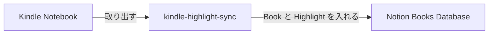

# kindle-highlight-sync

Kindle の Highlight と Note を、Notion の Books Database に同期する macOS 用 CLI。

[](https://github.com/ryokosuge/kindle-highlight-sync-cli/actions/workflows/ci.yml)
[](LICENSE)
[](https://github.com/ryokosuge/kindle-highlight-sync-cli/releases)

Amazon.co.jp の Kindle Notebook から Book ごとの Highlight と Note を取り出し、Notion の Books Database に Book のページと Highlight のブロックとして入れる。



図が描画されない環境では、Kindle Notebook から取り出した Book と Highlight が、Notion の Books Database に入る流れと読む。

Books Database には Book ごとに 1 ページができる（値は架空）:

| Title | Kindle ID | Author | ASIN | Last Annotated At |
| --- | --- | --- | --- | --- |
| 星降る図書館の地図 | B0EXAMPLE01 | 架空 太郎 | B0EXAMPLE01 | 2026-01-31 |

各ページには Highlight が引用として並び、Note があれば引用の下に本文だけが入る（Note の無い Highlight と、ある Highlight の例）:

> 夜の書庫では、本が自分の居場所を静かに覚えている。
> Location 120 · khs:a-3c91e5d2

> 地図の余白に書き込まれた線だけが、本当の道を指していた。
> Location 482 · Page 37 · khs:a-8b02f7a1

あとで読み返すとき、この余白の話から始める。

## 前提

- macOS（対象は macOS だけで、Linux / Windows は対象外。動作確認と配布をしない）
- Google Chrome（`login` と `sync` の実行時に使う。この CLI の brew の定義では一緒に入らないので、brew とは別に入れる。公式サイトからでも、brew の cask の `google-chrome` でもよい）
- Notion integration（その token が要る。作り方は [docs/notion-setup.md](docs/notion-setup.md) を参照する）

Homebrew（https://brew.sh/）で入れる。

ライセンスは MIT。詳細は [LICENSE](LICENSE) を参照する。

## Quick Start

```sh
brew install ryokosuge/tap/kindle-highlight-sync
kindle-highlight-sync login
kindle-highlight-sync init
kindle-highlight-sync sync
```

1. `brew install` は、tap の名前を含む完全修飾名で書く。
2. `login` は画面付きの Chrome を開く。開いた Chrome で Amazon にログインする（MFA の入力も同じ画面で行う）。
3. `init` は Notion token と Books Database を順に聞く。token は環境変数 `KINDLE_HIGHLIGHT_SYNC_NOTION_TOKEN` に設定しておくとそれを使い、設定が無ければ入力を求めて macOS Keychain に保存する（`config.toml` には token を書かない）。integration と Books Database の準備は [docs/notion-setup.md](docs/notion-setup.md) を参照する。
4. 最初の `sync` は Initial Sync で、作る Book と既存ページに結び付ける Book の件数を示して `Continue? [y/N]` と聞く。内容を確かめて `y` と答える（`y` 以外は exit 3 になる）。

更新は `brew upgrade kindle-highlight-sync` で行う。

## Notion の準備

integration を作って token を取り、Books Database に Property を用意して integration を接続する。手順と Property の表は [docs/notion-setup.md](docs/notion-setup.md) を参照する。

## ソースから build する場合

1. Go 1.27 以上を用意する。https://go.dev/dl/ の macOS 向けインストーラ、または `brew install go` でインストールできる。`go version` で確認する。
2. `git clone https://github.com/ryokosuge/kindle-highlight-sync-cli.git` を実行し、`cd kindle-highlight-sync-cli` でディレクトリに移動する。
3. `go build ./cmd/kindle-highlight-sync` でバイナリを build する。
4. `./kindle-highlight-sync --help` を実行する。説明 1 行に続けて、Usage・Available Commands・Flags の help 全体が表示される。`echo $?` で `0` を確認する。

build したカレントディレクトリのバイナリは `./kindle-highlight-sync` として呼ぶ。以降の節の例も `./kindle-highlight-sync` と書いている。brew で入れた場合は `kindle-highlight-sync` と読み替える。

## login

`./kindle-highlight-sync login` は、画面付きの Chrome を開く。「ブラウザで Amazon にログインしてください」と 1 行出るので、開いた Chrome で Amazon にログインする（MFA の入力も同じ画面で行う）。Kindle Notebook まで進むとコマンドは exit 0 で終わる。終了時に成功の文言は出ない。10 分以内に Kindle Notebook に届かないときは exit 2 になる。

ログインの状態は `browser-profile`（`$XDG_DATA_HOME/kindle-highlight-sync/browser-profile`、未設定時は `~/.local/share/kindle-highlight-sync/browser-profile`）に保存され、`sync` がそのまま使う。exit 2 などで止まったときは「つまずいたとき」を参照する。

## init

`./kindle-highlight-sync init` は、Notion token、Books Database、Data Source、Property の対応を順に確認し、`$XDG_CONFIG_HOME/kindle-highlight-sync/config.toml`（未設定時は `~/.config/kindle-highlight-sync/config.toml`）を作成する。token の用意は「Notion の準備」を参照する。うまくいくと `saved <config.toml のパス>` と `database_id:` などの設定内容が表示される。

`--database-id` で Database ID を指定できる。`--yes` は対話せず既定値だけで進めるため、token が見つからない場合、Data Source が複数ある場合、title または kindle_id の既定 Property がない場合は exit 3 になる。

`--force` は `config.toml` だけを作り直し、`browser-profile` と `state.db` は保持する。exit 3 は設定または確認が必要な場合、exit 4 は Notion API のエラーを表す。つまずいたときは「つまずいたとき」を参照する。

## sync

`./kindle-highlight-sync sync` は Kindle Notebook の Book と Highlight を取得し、Notion Books Database と照合する。`--headed` は画面付きの Chrome で動かす。

`state.db` に `initial_sync_completed_at` が無い実行は Initial Sync として扱い、Notion の既存ページと照合した予定を組んでから、Notion に新しく作る Book（Create）と既存ページに結び付ける Book（Adopt）の件数を示して `Continue? [y/N]` で確認を求める。既定は No で、`y` 以外の答えは exit 3 になる。入力が端末でないときは問いを出さずに exit 3 で止まるので、cron や launchd から動かすときは `--yes` を付ける。`--yes` は Initial Sync の確認を省いて進める。Create と Adopt がどちらも 0 件なら確認は出ない。

確認を通過した実行が成功するか、Book 単位の失敗（exit 8）で終わると `state.db` に `initial_sync_completed_at` を記録し、次回からは Initial Sync の予定の算出も確認も行わない。exit 8 になる Book 単位の失敗は、ASIN の無い Book、その Book の Highlight ページだけの構造の異常、Highlight ID が作れない Book、ambiguous の skip、1 冊の書き込みの失敗（400 / 429 / 5xx / タイムアウトなど）で、失敗した Book 以外は同期する。記録はブラウザを閉じ終えた後に行い、確認の前に止まる実行（Notebook 画面全体の構造の異常による exit 7 など）、確認を拒否した実行、設定が足りない実行（exit 3）、Amazon の認証が切れた実行（exit 2）、ブラウザを閉じるのに失敗した実行（exit 5）では記録しない。記録に失敗すると exit 6 になる。exit 2 / 3 / 4 / 5 / 9 で止まったときは「つまずいたとき」を参照する。

通常の `sync` が対象にするのは、`state.db` の `books` に記録が無い Book、Kindle の Last Annotated Date が無い Book、および Last Annotated Date が記録済みの `last_synced_at` の UTC の暦日の前日以降にある Book だけで、`last_synced_at` が Last Annotated Date より 2 日以上後の Book は Highlight の取得も Notion への要求も行わない。ASIN の無い Book は同期を終えられず記録が付かないので、常に対象に残る。`--full` を付けると `state.db` の記録に関わらず全 Book を対象にする。標準出力の末尾に `Target books  <対象の数> of <全 Book の数>` の行が出る。

`--dry-run` は Notion と State を変えずに Book の照合の結果と追記する Highlight の数だけを出す。確認も記録もせず、`state.db` も作らない（対象の選択のために `state.db` の `books` は読むが、無ければ作らず、あっても内容を変えない）。`--full` と併用すると全 Book の予定を出す。

## exit code

0 は成功。失敗したときは stderr の先頭に次の表の名前が出て、対応する値で終了する。対話式の `init` と、Initial Sync の確認（件数と `Continue? [y/N]`）を stderr に出した `sync` は、案内やプロンプトを先に stderr に出すため、名前はそれらの後に出る（確認を拒否した exit 3 や、`y` と答えた後に失敗した場合も同じ）。入力が端末でない `sync` や `--yes` の実行は確認を出さないので、名前は先頭に出る。

| 値 | 名前 | 意味 |
|---|---|---|
| 1 | general error | 上のどれにも当たらない失敗。`sync` が Notebook に届かず、認証切れとも判定されないときも含む |
| 2 | Amazon authentication required | Amazon の認証が切れている。`login` が 10 分以内に Notebook に届かないときも含む |
| 3 | configuration / confirmation required | 設定または確認が必要。Notion token が見つからない、`init` 時に integration が Books Database に接続されていない、Initial Sync の確認に `y` 以外を答えた（または端末でない）ときなど |
| 4 | Notion error | `sync` 中の Notion の失敗のうち、認証・権限・対象が無い（401 / 403 / 404）など、残りの Book を書かずに止まるもの。1 冊の書き込みの失敗（400 / 429 / 5xx / タイムアウトなど）は exit 8 |
| 5 | browser error | Chrome の起動または終了の失敗 |
| 6 | local state / ID scheme error | `state.db` の読み書きの失敗、または ID の方式が合わない |
| 7 | source format error | Kindle Notebook 画面全体の構造が想定と違う |
| 8 | partial failure | Book 単位の失敗。1 冊の書き込みの失敗（400 / 429 / 5xx / タイムアウトなど）、その Book の Highlight ページだけの構造の異常、Highlight ID が作れない Book、ASIN の無い Book、照合が ambiguous で skip した Book。失敗した Book 以外は同期する。Notebook 画面全体の構造の異常は exit 7 |
| 9 | already running | 別の `kindle-highlight-sync` が実行中 |

exit 2 / 3 / 4 / 5 / 9 の原因と次の手は「つまずいたとき」を参照する。

## つまずいたとき

exit code ごとの原因と次の手。値と名前の一覧は「exit code」の表を参照する。

### exit 2: Amazon の認証が切れている

`sync` の stderr に `run` で始まる `login` の案内が出る。Amazon のログイン状態（`browser-profile`）が切れているのが原因。`./kindle-highlight-sync login` を実行し、開いた Chrome で Amazon にログインし直してから `sync` をもう一度実行する。`login` 自身が exit 2 になるときは、10 分以内に Kindle Notebook に届かなかった。もう一度 `login` を実行する。

### exit 3: 設定または確認が必要

stderr の文言で原因を見分ける。

- `config.toml` が無い。stderr に `init` を案内する文言が出る。`./kindle-highlight-sync init` を実行する。
- `config.toml` はあるが Notion token が見つからない。stderr には同じく `init` を案内する文言が出るが、`config.toml` が既にあると `init` は `init --force` を案内して止まる。次のどちらかで token を渡す。
  - Keychain に保存する。`./kindle-highlight-sync init --force` を実行して token を入力する。`config.toml` だけを作り直し、`browser-profile` と `state.db` は保持する。
  - 環境変数 `KINDLE_HIGHLIGHT_SYNC_NOTION_TOKEN` に token を設定して `sync` を実行する。
- `config.toml` が壊れている。`./kindle-highlight-sync init --force` で作り直す。
- `init` 時に integration が Books Database に接続されていない。stderr に日本語の接続手順が出る。「Notion の準備」の手順 3 のとおり接続してから、もう一度 `init` を実行する。
- Initial Sync の確認が通っていない。端末でない入力（cron や launchd など）で動かしたときは stderr に `--yes` の案内が出る。端末で `y` 以外を答えたときも同じ exit 3 になる。内容を確かめて進めるなら、`./kindle-highlight-sync sync` を端末で動かして `y` を答えるか、`./kindle-highlight-sync sync --yes` を実行する。

### exit 4: Notion に繋がらない、または権限が足りない

`sync` 中に Notion が認証・権限・対象なし（401 / 403 / 404）を返したときに止まる。原因は、token の失効、integration の Books Database への接続が外れた、権限不足、Database の ID 違いのどれか。確かめる場所は Notion の Books Database の「接続」の設定（「Notion の準備」の手順 3）で、integration が追加されているかを見る。

次の手は `./kindle-highlight-sync init --force` で `config.toml` と token を作り直すこと。token を差し替えるときも `init --force` を使い、新しい token を入力する。環境変数 `KINDLE_HIGHLIGHT_SYNC_NOTION_TOKEN` を設定している間は、そちらが優先され Keychain には保存されない。環境変数の値が古くないかも確かめる。`init --yes` は token を保存しない。

### exit 5: Chrome を起動できない

`login` と `sync` が Chrome を起動できなかった。Chrome の場所を指定する環境変数・フラグ・設定は無く、chromedp の既定の場所から探す。macOS では `/Applications/Google Chrome.app`（または `/Applications/Chromium.app`）にインストールされている必要がある。`/Applications` に Google Chrome を入れてからもう一度実行する。ブラウザを閉じるのに失敗したときも exit 5 になる。その場合は残っている Chrome のプロセスを終了して、もう一度実行する。

### exit 9: 別の実行が動いている

別の `sync` か `login` が実行中のときに起きる。launchd や cron の定期実行と、手で打った実行が重なる場合が典型。実行中の `sync` / `login` が終わるのを待ってから、もう一度実行する。排他は `run.lock`（`$XDG_DATA_HOME/kindle-highlight-sync/run.lock`、未設定時は `~/.local/share/kindle-highlight-sync/run.lock`）のロックで行い、プロセスが終わればロックは外れる。ファイルが残っているだけでは exit 9 にならず、手で消す必要は無い。
